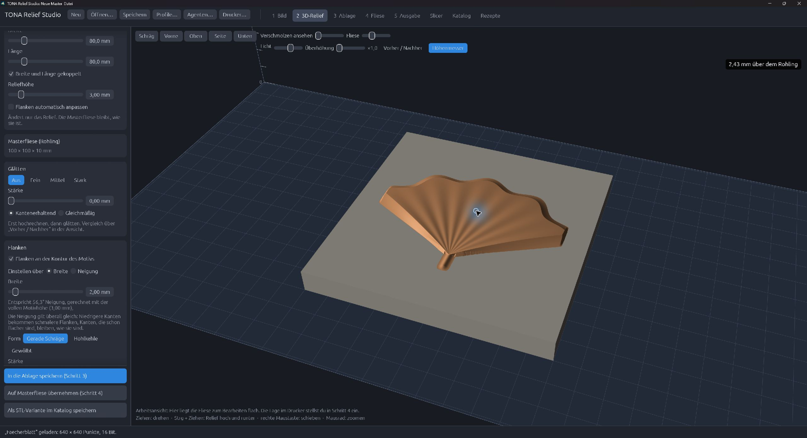
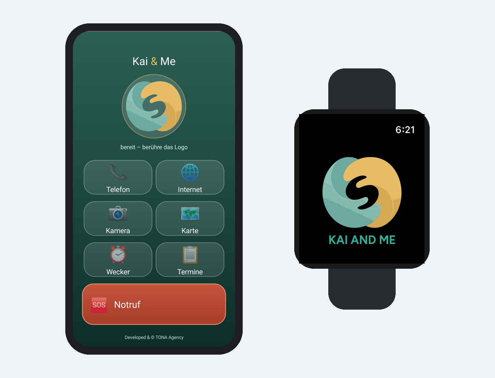
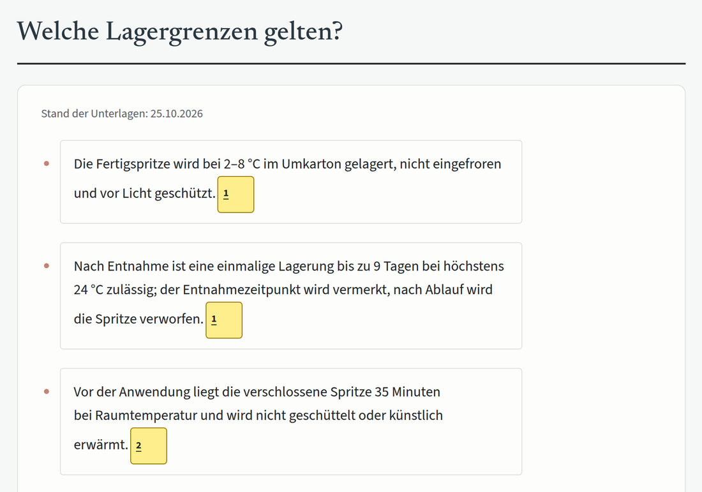

# TONA Agency

Eine Marke von TONA Arts. Hier zeigen wir drei unserer Anwendungen: das TONA Relief Studio, den Alltagsbegleiter KAI AND ME und eine Wissensplattform für die Pharmabranche.

[Portfolio](https://projekte.tona.agency) · [TONA Agency](https://tona.agency)

## TONA Relief Studio

Vom Bild zur druckfertigen Masterfliese, in einem Programm. TRS macht aus einem Foto, einer Zeichnung oder einer Höhenkarte ein räumliches Relief, setzt es auf einen Fliesenrohling und bereitet es für den Harzdruck vor. Höhe, Glättung und Flanken lassen sich gezielt einstellen, ein Höhenmesser zeigt die Höhe an jeder Stelle. Stützen und Druckschichten sind vor dem Druck sichtbar. Desktop-Programm für Windows, in Entwicklung.

[Projekt im Portfolio](https://projekte.tona.agency/#relief-studio)

## KAI AND ME

KAI AND ME ist ein Gesprächsbegleiter mit Erinnerungen für Menschen mit Gedächtnisproblemen, für iOS und Android. Die Android-Fassung hat große Tasten, einen Notruf, Wecker und Termine. Betreuer pflegen Inhalte über eine eigene Seite. Die neue iOS-Fassung kann Gespräche auch mit einem Sprachmodell direkt auf dem Gerät führen. In Weiterentwicklung als Baustein von TONA Agency.

[Projekt im Portfolio](https://projekte.tona.agency/#kai-and-me)

## Pharma-Wissensplattform

Ein gemeinsamer Anwendungskern verbindet Dialog · Onboarding · Prüfen · Objection Handler mit Battle Cards in getrennten Einsätzen. Jede Antwort ist an Stellen in den Fachunterlagen gebunden. Die Quellen sind gelb markiert und lassen sich öffnen. Im Einsatz in mehreren Anwendungen. Das Bild stammt aus einer Demo mit erfundenen Unterlagen.

[Projekt im Portfolio](https://projekte.tona.agency/#pharma-wissensplattform)

Die Code-Repositories sind privat.

## English

TONA Agency is a brand of TONA Arts.

**TONA Relief Studio** takes an image to a print-ready master tile in one application: relief from photo, drawing or height map, tile blank, supports and resin-print output, with a height gauge for precise control. Windows desktop application, in development.

**KAI AND ME** is a conversational companion with everyday reminders for people with memory problems, for iOS and Android. The Android version has large buttons, an emergency call, alarms and appointments, and caregivers maintain content on a separate page. The new iOS version can also run its language model directly on the device. Being developed further as a TONA Agency building block.

**Pharmaceutical knowledge platform** brings together Dialog, Onboarding, Prüfen and Objection Handler with Battle Cards. Separate deployments share a core for source retrieval and checked answers. In use; the image contains fictional demonstration material.

[Project portfolio in English](https://projekte.tona.agency/en/) · [TONA Agency](https://tona.agency)
